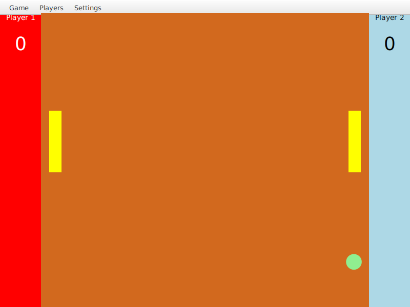

# The Ping Pong Game

A two-player Pong game for the desktop, built with **Java** and **JavaFX**. Matches can be saved to a local file or to a **PostgreSQL** database and picked up again later.

> Built as a college assignment for an Object-Oriented Programming in Java module.



## Features

- Local two-player game on one keyboard
- Ball speeds up after every few racket hits
- Resizable window: the court, ball and rackets scale with it
- Adjustable settings: player names, ball speed, racket size, winning score and speed-up factor
- Save and load a game **to a file** (Java serialization) or **to a database** (PostgreSQL via JDBC)
- Pauses automatically while a menu or dialog is open
- Unit tests for collisions, movement and saving (JUnit 5)

## Controls

| Action        | Player 1 (left) | Player 2 (right) |
|---------------|:---------------:|:----------------:|
| Move up       | `W`             | `↑`              |
| Move down     | `S`             | `↓`              |
| Pause / resume| `Esc`           | `Esc`            |

Restart, save/load and exit are in the **Game** menu; names are under **Players**; game rules are under **Settings**.

## Getting started

**Requirements:** Java 21+ and Maven. JavaFX and the PostgreSQL driver are downloaded by Maven.

```bash
git clone https://github.com/<your-username>/the-ping-pong-game.git
cd the-ping-pong-game
mvn javafx:run
```

Run the tests with:

```bash
mvn test
```

### Database (optional)

Saving to a file works out of the box. To use **Save to Database / Load from Database**, have PostgreSQL running and create the database:

```sql
CREATE DATABASE pong_db;
```

The `game` table is created automatically on first use. By default the game connects to `jdbc:postgresql://localhost:5432/pong_db` as `postgres` / `postgres`. Override any of these with environment variables:

```bash
export PONG_DB_URL=jdbc:postgresql://localhost:5432/pong_db
export PONG_DB_USER=postgres
export PONG_DB_PASSWORD=your_password
mvn javafx:run
```

If the database isn't reachable, the game shows a message and keeps running.

## How it's built

| Concept | Where |
|---|---|
| **MVC** with FXML | `pong-view.fxml` (view), `PongController` (controller), `model/` (model) |
| **Inheritance** | `Ball` and `Racket` extend `PosAndSpeed` |
| **Interfaces** | `Resizable` (scaling with the window), `GameDAO` |
| **Singleton** | `DatabaseConnection`, `GameDataManager` |
| **DAO** | `GameDAO` / `GameDAOImpl` keep the SQL out of the UI |
| **Builder** | `GameBuilder` rebuilds a `Game` from a database row |
| **Multithreading** | `BallManager` runs the game loop on a background thread and updates the UI with `Platform.runLater` |
| **Serialization** | `GameDataManager` writes the whole `Game` object graph to `pong_save.dat` |

`HeapStressTest` and `StackStressTest` are small standalone programs that push the JVM until it runs out of heap memory or stack space, to show the difference between the two.

## Project structure

```
src/
├── main/
│   ├── java/
│   │   ├── module-info.java
│   │   └── com/example/the_ping_pong_game/
│   │       ├── PongApplication.java     # entry point
│   │       ├── PongController.java      # UI, input, menus, save/load
│   │       ├── GameCanvas.java          # drawing and resizing
│   │       ├── Resizable.java
│   │       ├── HeapStressTest.java
│   │       ├── StackStressTest.java
│   │       ├── model/                   # Game, Ball, Racket, Player, Scoreboard, PosAndSpeed
│   │       ├── manager/                 # BallManager (game loop), CollisionManager, GameDataManager
│   │       └── database/                # DatabaseConnection, GameDAO, GameDAOImpl, GameBuilder
│   └── resources/com/example/the_ping_pong_game/
│       └── pong-view.fxml
└── test/java/com/example/the_ping_pong_game/
    ├── manager/CollisionTest.java
    └── model/GameStateTest.java
```
